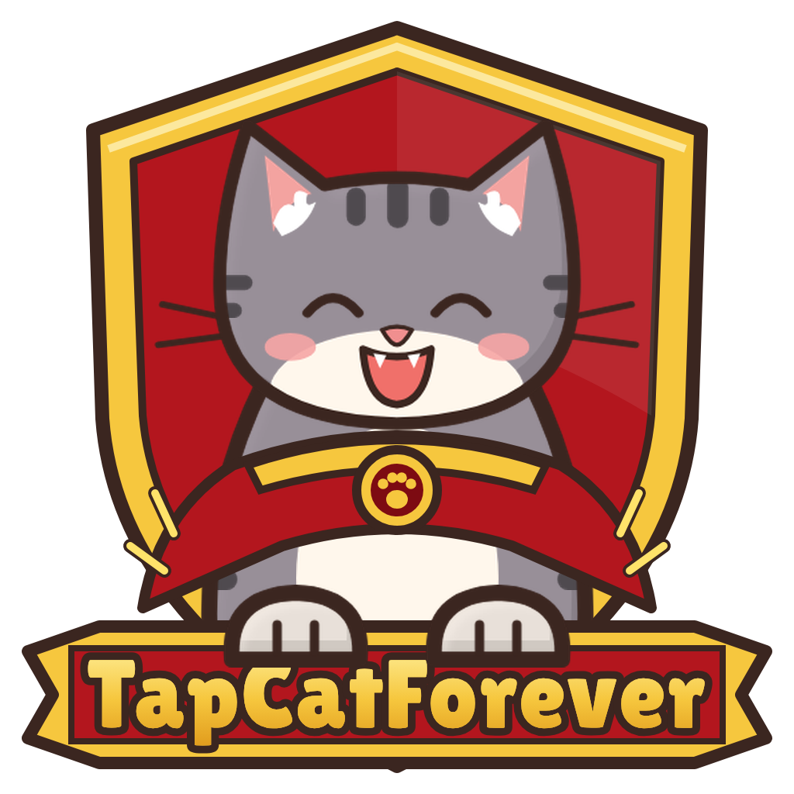

# CurseForge page text

## Summary (under 256 characters)

A cartoon cat taps along with every key you press. Level a cat for each class, dress it in real WoW gear, fight through dungeons and raids, run idle professions and open loot chests. Made for WoW: Forever.

## Description

TapCatForever
=============

**A little cartoon cat lives on your screen and taps its paws every time you press a key.** Every keystroke you already make in World of Warcraft earns your cat XP and TapCoins, and behind it is a whole collection game: real WoW gear, class abilities, an idle Adventure through Azeroth's dungeons and raids, professions, loot chests and hundreds of things to collect.

It never touches your gameplay. It just watches your key presses and makes them a little more fun.

Features
--------

**A cat that taps with you**
- Left paw on A, left arrow and left-click; right paw on D, right arrow and right-click; every other key alternates.
- Happy, focused and sparkly faces, and Tap Effects (hearts, stars, fire sparks, rainbow stars and more) that burst from its paw on every tap.
- Drag it anywhere, resize it, fade it, or hide everything but the cat.

**A cat for every class**
- Each class has its own cat that levels from 1, with its own gear, abilities and progress.
- Your cat wears real WoW items: every helm, chest, belt, necklace, ring, weapon, shield and off-hand has its own hand-drawn cartoon version, about 4,500 items in all.
- Learn class abilities with TapCoins, from Heroic Strike to Pyroblast.

**Adventure**
- An idle fight through 28 real zones, dungeons and raids, from Elwynn Forest and the Deadmines to Molten Core and Naxxramas, each with its own hand-drawn scene.
- Real bosses and real creature models. Your cat casts its abilities with visible spell effects, and an ability bar shows every cooldown.
- Bosses drop chests and rare cats, and real loot from each zone can turn up.

**Expeditions**
- Send a party of three cats away for 15 minutes to 24 hours. They come back with TapCoins, chests and XP.

**Professions**
- Your cat's class picks its main profession: Mining with Blacksmithing (Warrior, Paladin), Skinning with Leatherworking (Rogue, Druid, Hunter, Shaman) or Tailoring (Mage, Priest, Warlock). Each is an idle gathering business with hired helpers and an endless tool upgrade, and it crafts real Classic gear with stats (cosmetic-only recipes are marked). Herbalism, First Aid, Fishing and Cooking unlock later: a garden that grows in real time, bandages that heal your cat in fights, fishing from a dock with a fishing buddy, and recipes you discover by experimenting.
- Sell your business for Renown to grow faster and unlock new professions.

**Chests, shop and collecting**
- Cat Treat Pouches, Adventurer's Strongboxes and Heroic Caches, opened with a spinning reel that lands on your reward. Gear you find anywhere else goes straight into your bags with a small notice.
- Finishing real dungeons and raids in WoW earns chests too.
- Daily shop wares, daily and weekly quests, and 77 achievements.
- Hats, capes, wings, fur patterns, effects and dozens of cat skins: tabbies and tuxedos, Frostsabers, the Spectral Tiger, and achievement cats like Mr. Bigglesworth.
- Racial heritage items for your character's race.

**Account and character**
- Gear, cosmetics, professions and cat levels belong to each character; TapCoins, quests and achievements are shared across your account.

**Play with friends**
- Group up with friends who also have TapCatForever and their cats sit in a little row beside yours. Hover one to see whose cat it is.
- While at least one of them is in your group, every tap you make counts as 1.5 taps: more tap progress, cat XP and TapCoins from tapping. It works in parties, raids and dungeon groups.
- The addons find each other on their own, so there is nothing to set up. Invite a friend and play together.

Getting started
---------------

Install, log in, and the welcome tour shows you around. Right-click the cat to open the main window. Start in the Adventure tab, and check the Treasure Bag whenever you earn a chest.

Slash commands
--------------

- **/tcf** or **/tapcat**: open the main window
- **/tcf welcome**: show the welcome tour again
- **/tcf bag**: open the Treasure Bag
- **/tcf show**, **/tcf hide**, **/tcf toggle**: show or hide the cat
- **/tcf lock**, **/tcf unlock**: lock the cat in place
- **/tcf reset**: move the cat back to the middle of the screen
- **/tcf scale 0.3-3**: resize the cat
- **/tcf stats**: your totals

FAQ
---

**Does it change how I play?**
No. It only listens to your key presses and mouse clicks and never presses anything for you.

**What counts as a tap?**
Every key press (movement, abilities, everything except typing in chat), every mouse click, and your spell casts. Your cat keeps tapping in combat too.

**Can I turn off the sounds, chat messages or chest animation?**
Yes, all of them are in Settings (right-click the cat, then the Settings tab). Sounds and chat messages start off.

**Can I start over?**
Settings has "Reset this character" and "Reset ALL progress".

Feedback and bugs
-----------------

Found a bug or have an idea? Leave a comment here or open an issue on [GitHub](https://github.com/verifiedsupreme/TapCatForever/issues). If you can, include the error text (type `/console scriptErrors 1` to see errors).
