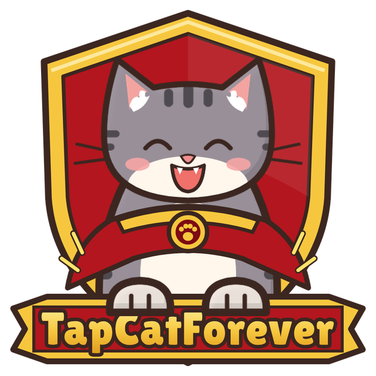
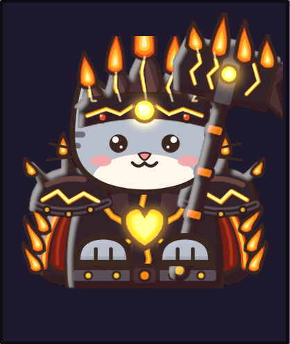
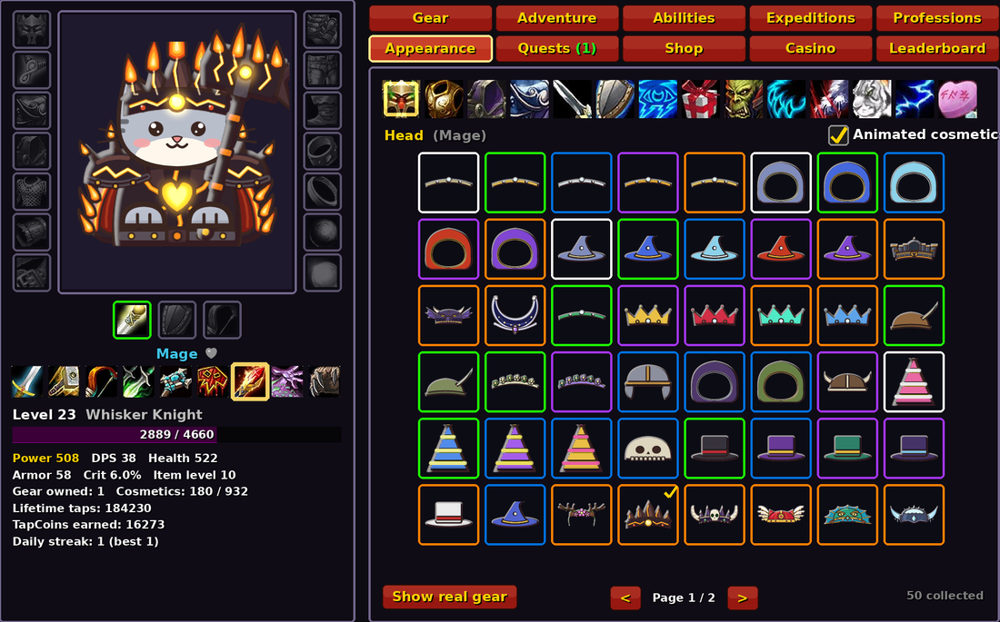
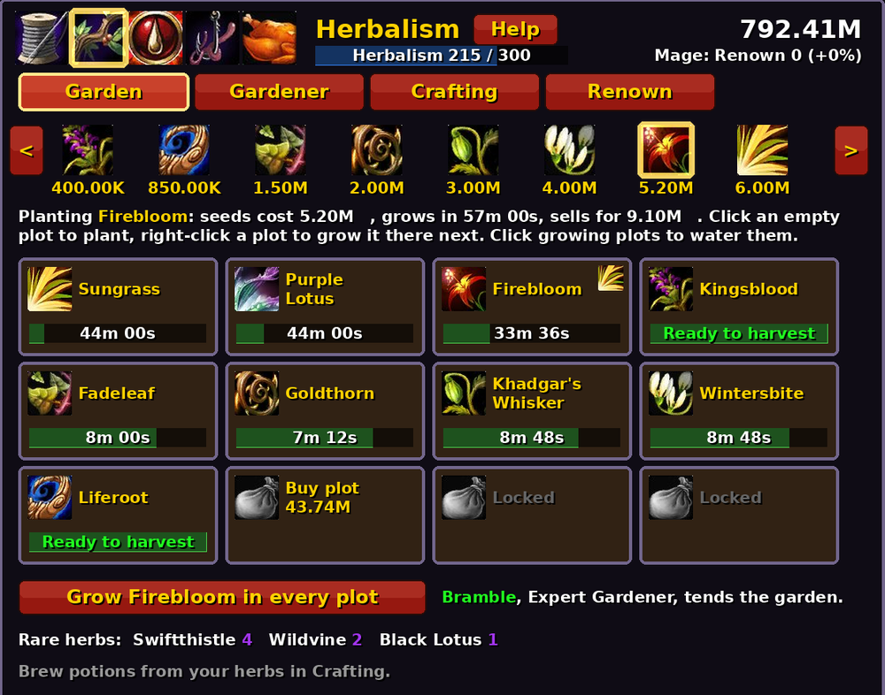
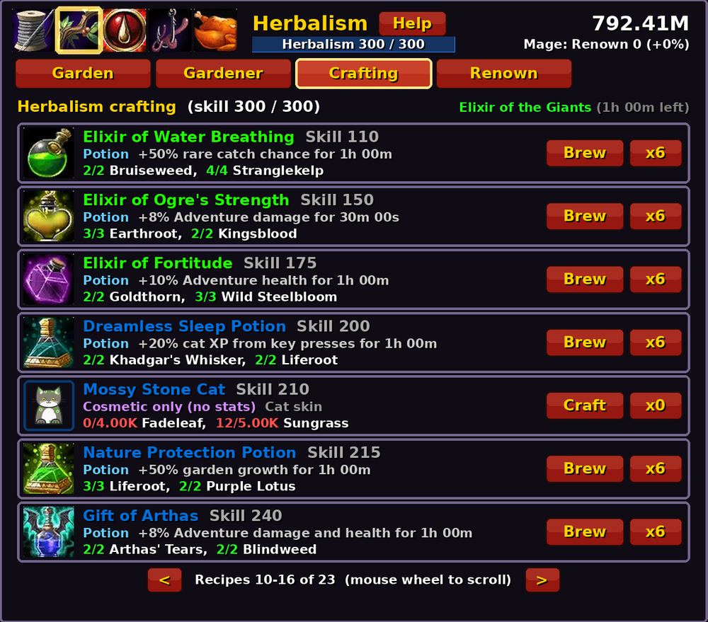
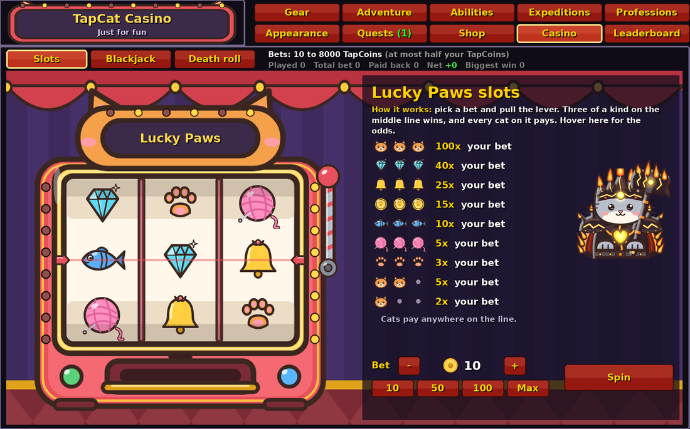
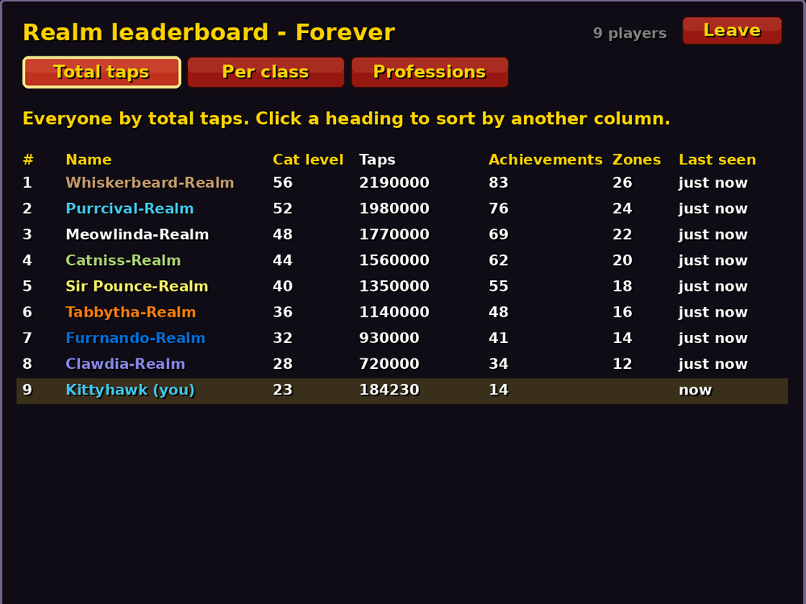
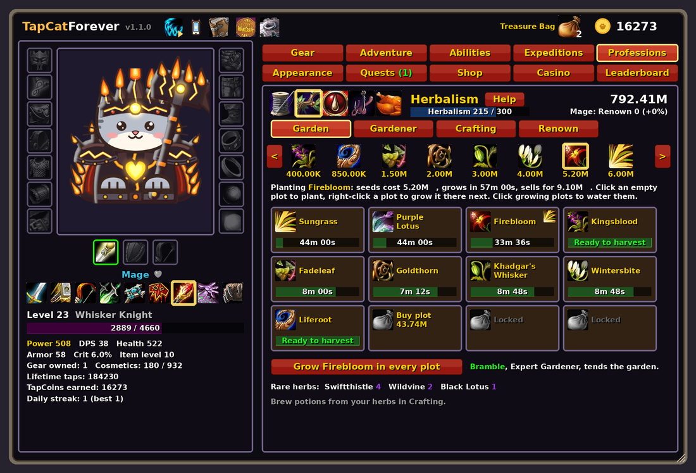

### A little cartoon cat lives on your screen and taps its paws every time you press a key.

Every keystroke you already make in World of Warcraft earns your cat XP and TapCoins, and behind it is a whole collection game: real WoW gear, class abilities, an idle Adventure through Azeroth's dungeons and raids, class professions that craft real gear, loot chests and hundreds of things to collect. It never touches your gameplay. It just watches your key presses and makes them a little more fun.

*This is my first addon, and I'm so glad you're here. I update it often, so keep it up to date for the newest features and fixes. If you have an idea or find a bug, I'd love to hear it: type /tcf feedback in game or use the link at the bottom of this page.*

---

## What your cat gets up to

### A cat that taps with you

Every key you press, every click and every spell you cast, your cat taps its paws along. Left paw on A, right paw on D. It pulls faces, bursts hearts and stars from its paws, and quietly earns XP and TapCoins while you play the real game.

### Nine cats, one adventure

One cat for every class, each levelling from 1 to 60 with its own real WoW gear and abilities. Send it through Elwynn Forest, the Deadmines, Molten Core and all the way to Naxxramas: real bosses, real loot tables, bosses you can farm, all while you play.

### Dress it up

Hundreds of hats, capes, skins and tap effects, eleven animated dungeon sets with flames, frost and stars, and real gear that shows on your cat. Shift-click anything to try it on first. The rarest skins drop from Ragnaros, Nefarian and Kel'Thuzad.

### Run a business

Mining, skinning or tailoring for your class, with spots, helpers and upgrades that work even while you're offline. Craft real gear, unlock herbalism, first aid, fishing and cooking, and sell up for Renown to grow even faster.

### Grow a garden

26 real Classic herbs from Peacebloom to Icecap, a different seed in every plot, and Bramble the gardener, who harvests and replants while you're away and trains from Apprentice to Master. Lucky harvests bring Swiftthistle, Wildvine and Black Lotus.

### Brew potions

Turn your herbs into 17 classic elixirs and flasks, from Elixir of Lion's Strength to Flask of the Titans, and drink them for more damage, health, XP or gold. They stack with your Well Fed food.

### The cat casino

Lucky Paws slots, blackjack, a death roll in a cosy tavern and rock paper scissors (best of 1, 3 or 5) on a snowy mountaintop. Play the house cat, or challenge a friend in your party for TapCoins.

### Better with friends

Group up with friends who have the addon: their cats sit beside yours, your taps count up to 50% more, you can send your cats on party expeditions together, check out each other's cats and climb the realm leaderboard.

### Your window, your way

A big window with your cat and its gear, fold the character panel away, or switch to a phone-sized view with big round buttons. Quests, achievements, chests with a loot reel, and a Compendium of every item and how to get it.

---

## What's new in 1.6

- A much deeper Herbalism: 26 real herbs, rare Swiftthistle, Wildvine and Black Lotus, a seed for every plot, and Bramble the gardener to train from Apprentice to Master.
- Brew 17 classic potions and flasks from your herbs and drink them for buffs on top of your Well Fed food.
- Rock paper scissors in best of 1, 3 or 5, against the house cat or a friend.
- Happy Purrs: pet your cat 100 times in a row for +5% XP for an hour, and unlock 27 pet effects (fireballs, lightning, poison, yarn balls, fishies, rainbow hearts and more) by coming back on more days.
- Gear that fits your class: Equip best now picks Spell Power and Intellect for casters, Strength for Warriors and Paladins and Agility for Hunters and Rogues, like WoW.
- Shift-click any item to try it on your cat before you wear or buy it.
- Multiplayer works: death roll and rock paper scissors with a friend, party cat profiles with their taps, and a realm leaderboard that fills in from your party.
- The cat Casino, animated cosmetic sets, a resizable window, and your cats shared by every character on your account.

Full patch notes are in the game: Settings > Patch notes, or type `/tcf news`.

### Earlier highlights

- **1.5**: Class professions that craft real gear, real legendaries, party cats with a tap bonus, a fishing dock, 33 new skins, the Compendium, party expeditions and the realm leaderboard.
- **1.4**: Every zone filled with its real Classic creatures and bosses, death animations and floating damage numbers.
- **1.3**: Hand-drawn Adventure backgrounds for all 28 zones, the chest opening reel and spell effects in fights.
- **1.2**: The cartoon cat, a drawing for every visible item, real WoW gear with real stats, Adventure through Azeroth, expeditions, professions and cat skins.

---

## Getting started

Install, log in, and the welcome tour shows you around. Right-click the cat to open the main window. Start in the Adventure tab, and check the Treasure Bag whenever you earn a chest. After a big update, a short What's new note appears at the top of the window.

## Slash commands

- `/tcf or /tapcat`: open the main window
- `/tcf compendium`: every item and how to get it
- `/tcf news`: patch notes
- `/tcf top`: the Leaderboard tab
- `/tcf feedback`: report a bug or suggest an idea
- `/tcf welcome`: show the welcome tour again
- `/tcf bag`: open the Treasure Bag
- `/tcf show, /tcf hide, /tcf toggle`: show or hide the cat
- `/tcf lock, /tcf unlock`: lock the cat in place
- `/tcf reset`: move the cat back to the bottom middle of the screen
- `/tcf scale 0.3-3`: resize the cat
- `/tcf stats`: your totals

## FAQ

**Does it change how I play?**
No. It only listens to your key presses and mouse clicks and never presses anything for you.

**What counts as a tap?**
Every key press (movement, abilities, everything except typing in chat), every mouse click, and your spell casts.

**Can I turn off the sounds, chat messages or chest animation?**
Yes, all of them are in Settings (right-click the cat, then the Settings tab). Sounds and chat messages start off.

**Where are the patch notes?**
In Settings > Patch notes, or type /tcf news.

**Does it send anything about me?**
Only if you turn on Share my cat's progress in Settings > Help and info, which is off by default. Then your character's name and realm, cat class, cat level, the level of each of your class cats, total taps, achievements earned, Adventure zones cleared, Trade Gold earned, your best profession skills and addon version are sent to other TapCatForever players who turned it on when you are in a party, raid or guild with them (and on an addon channel where the game allows it), and they see them on the leaderboard, passed between players inside the game. Other addons in your group or guild could read what is shared. The option is for your whole account, and since taps and achievements are shared between your characters, other players may be able to tell your characters on the same realm belong together. When you play death roll or rock paper scissors with a friend, your addon sends the challenge, the bet, the rolls or the locked-in picks to your party or raid. When you invite your group on a party expedition or answer an invite, it sends the invite or your answer, the cats you picked and their Power to your party or raid. When the developer asks, it also answers with your addon version, cat class, cat level, zones cleared and TapCoins. Nothing else is sent, and nothing goes over the internet.

**Can I start over?**
Settings has "Reset this character" and "Reset ALL progress".

## Feedback and bugs

Found a bug or have an idea? Type /tcf feedback in game, leave a comment here, or open an issue on GitHub ([https://github.com/verifiedsupreme/TapCatForever/issues](https://github.com/verifiedsupreme/TapCatForever/issues)). If you can, include the error text (type /console scriptErrors 1 to see errors).
