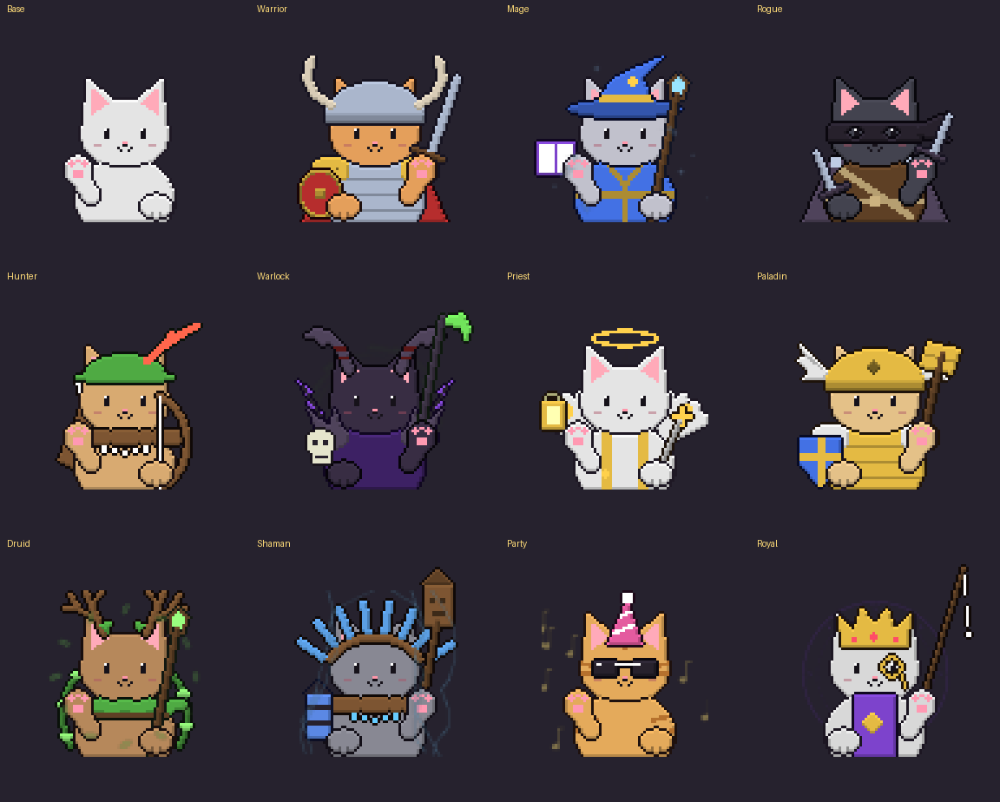

# TapCatForever

Built for **World of Warcraft: Forever** (interface 16001). A small pixel-art cat lives on your WoW screen and taps its paws every time you press a key.
Every key press earns XP and TapCoins. Level the cat up, collect class-themed gear, and dress it as any of the nine classic classes.

## Features
- **Tapping cat.** Keys on the left half of the keyboard tap the left paw, the rest tap the right paw. Mouse clicks count too (this can be turned off). The cat blinks, makes a "focus" face during a Paw Frenzy (7+ taps a second) and sparkles when it gets loot.
- **9 classes.** Warrior, Paladin, Hunter, Rogue, Priest, Shaman, Mage, Warlock and Druid. Each class has its own gear (head, chest, back, main hand, off hand) in five material tiers, from Rusty or Novice's up to Titanforged, Ashbringer, Dragonstalker and the rest. Each class also has its own effects, and keeps its own saved outfit.
- **612 cosmetics** in Common, Uncommon, Rare, Epic and Legendary. They include fur colours (with animated Prismatic and Spectral furs), fur patterns, accessories, party hats, crowns, fishing poles and more. Legendary head and chest pieces shimmer.
- **Progression.** Levels and titles (Kitten up to Eternal Tapper), a lifetime tap counter, TapCoins (earned mostly from quests and Adventure, plus a trickle from key presses, level-ups and daily logins).
- **Loot.** Random drops while you tap, three kinds of treasure chest, free chest keys every 5 and every 20 levels, and duplicates salvaged into TapCoins.
- **Real gear.** 8,661 real Classic items with real stats and drop sources, 17 gear slots per class, and Classic armor/weapon rules.
- **Adventure.** An idle game through 28 real zones, dungeons and raids with their real bosses and loot, 3D creature models and each dungeon's artwork.
- **Class abilities.** Learn real class abilities with TapCoins; the cat uses them in fights.
- **Expeditions.** Send parties of 3 cats away for real time to bring back TapCoins, chests and gear.
- **Professions.** An idle tycoon: buy and automate gathering operations, earn Trade Gold, prestige for Renown, and craft exclusive cosmetics from the materials.
- **Racial heritage.** Each character's cat gets an accessory for its race.
- **Quests.** Daily and weekly quests for TapCoins and free chests.
- **Real dungeon and raid rewards.** Finish a dungeon or raid in WoW and your cat gets a chest.
- **Daily shop.** Three items a day, with a re-roll option.
- **43 achievements**, with TapCoin rewards and exclusive cosmetics such as the Crown of the Tapmaster.
- **Shared progression.** Every character on the account shares the same level, coins, collection and achievements.
- **Fits around your UI.** Drag it anywhere, scale it from 0.3x to 3x, change its opacity, hide every counter (cat-only mode), and make it click-through when locked.

## Install
Copy the `TapCatForever` folder to `World of Warcraft\_forever_\Interface\AddOns\`, or install it through the CurseForge app with your Forever installation selected.

## Usage
- Left-click the cat to pet it. Right-click it to open the wardrobe, shop, achievements and settings. Drag it to move it.
- Ctrl + mouse wheel over the cat resizes it. Shift + mouse wheel changes its opacity.
- `/tapcat` (or `/tcf`) opens the window. Subcommands: `show`, `hide`, `toggle`, `lock`, `unlock`, `reset`, `scale <n>`, `stats`.
- Minimap button: left-click opens the window, right-click shows or hides the cat.

## Development
Data sources (regenerate `GearData.lua` with `python3 tools/make_gear.py <data-dir>`):
- Items: the MIT-licensed [wow-classic-items](https://www.npmjs.com/package/wow-classic-items) package (`npm pack wow-classic-items@2.0.1`, then untar into `<data-dir>`).
- Creature models and dungeon artwork: WoW client data tables exported by wago.tools (`Creature`, `JournalEncounterCreature`, `JournalInstance` as CSV into `<data-dir>`). The addon only references file IDs already in the game client.
- `python3 tools/trade_sim.py [hours]` simulates the Professions tycoon with optimal buying.
- `python3 tools/balance.py [CLASS ...]` simulates Adventure with typical real gear at each level, for tuning enemy strength.

- `python3 tools/make_art.py` regenerates every texture in `Art/` and `ArtData.lua`.
- `python3 tools/preview.py out.png` renders a sheet of outfits.
- `python3 tools/test_harness.py` runs the addon against a mocked WoW API (needs `pip install lupa`).
- Releases: bump `## Version:` in `TapCatForever.toc`, add a CHANGELOG entry, then push to the `release` branch (or push a tag like `v1.1.1`). `.github/workflows/release.yml` tags the version, packages the addon and uploads it to CurseForge.
