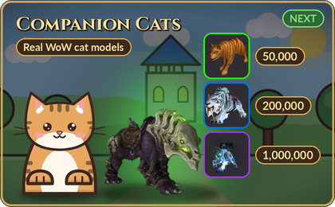
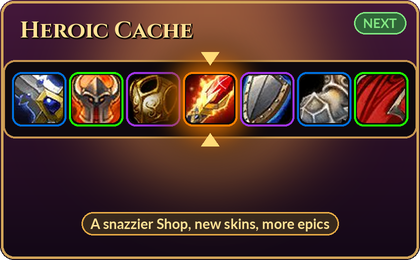
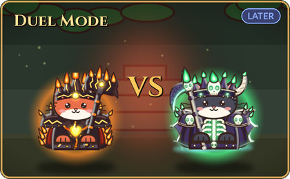
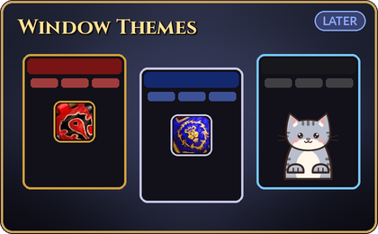
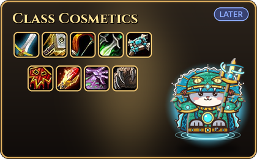
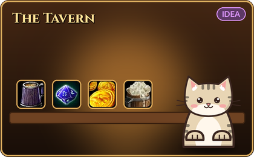
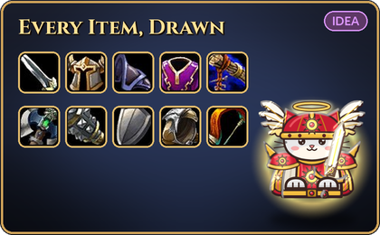
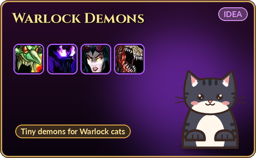

# TapCatForever Roadmap

What we're building next for your cat, what comes after that, and ideas we're still playing with. Plans can change. The newest release is **1.7.0, Professions 2.0** (see [patch-notes/latest.md](patch-notes/latest.md)).

**Next** means we're building it now. **Later** means it's planned after that. **Idea** means we like it but haven't decided yet.

---

## Next

### Companion Cats

Real WoW cat models as companions for every cat, not only Hunters. WoW has a lot of them: house cats, kittens and cubs, lynxes, sabers, tigers, lions, panthers, the Felsaber, the Spectral Tiger and more (over 50 to collect). These are the game's own 3D models, not drawings.
- A new companion slot on the character panel, with your companion's model beside your cat.
- They're hard to get. House cats start at 50,000 TapCoins, kittens and cubs cost 100,000 to 150,000, and the big cats go up to 500,000. The glowing, fel and spectral cats cost up to 1,000,000.
- Some can only be earned by clearing big dungeons and raids in Adventure, from the Deadmines to Naxxramas (Mr. Bigglesworth).
- Companions you own work for all your cats, and each class's cat chooses its own.
- **Companion Stroll** is the biggest buy in the game at 1,000,000 TapCoins. Your companion walks back and forth beside your cat on screen, opposite the party cats, at their size. You can turn it off any time.
- It has a life of its own:
  - It wanders, sits down and sometimes curls up for a nap.
  - It gets curious when you're on a long tapping streak and comes a few steps closer to watch.
  - When you pet your cat, it comes right over, sits and keeps its eyes on your cat, and hops when your cat purrs.

### A Snazzier Shop and Heroic Cache

- A redesigned Shop with room for all the new skins.
- The Heroic Cache costs a little more and feels better to open. The reel spins faster and shows more epics and rares, with a wider mix of items.
- The best items stay rare. Low-level cats still won't get huge high-level items, but they'll see what they could win.

---

## Later

### Duel Mode

Your cat fights a friend's cat on its own with what it has: gear, abilities, bandages and food.

### Window Themes

Restyle the main window with TapCoins: a sleek modern look, colour reskins, and Horde or Alliance themes.

### Class Cosmetics

Cosmetics made for each class, so a Warrior cat and a Mage cat can look different.

---

## Ideas

### The Tavern

Real WoW props (mugs, dice, coins) in the death roll and rock paper scissors arena.

### Every Item, Drawn

Draw every piece of gear on the cat the way it really looks in game.

### Warlock Demons

Tiny classic demons (imp, voidwalker, succubus, felhunter) as companions for Warlock cats.

---

## Recently shipped

- **1.7.0, Professions 2.0:**
  - rare finds and glints by hand, named helpers, specializations with daily crafts
  - guilds with work orders, Masterwork gear, a Renown shop and titles
  - a Profession Bag, 11 legendary crafted sets, and orange TapCoins
- **1.6.8:** tapping and petting faces.
- **1.6.7:**
  - a deep Herbalism with a gardener and 17 potions
  - rock paper scissors best of 3 and 5

The full history is in [CHANGELOG.md](CHANGELOG.md).

*Pictures are made with `tools/make_roadmap.py`. Patch notes for Discord are in [patch-notes/](patch-notes/).*
